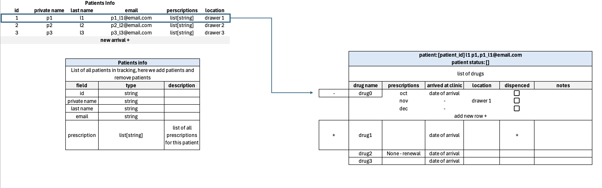
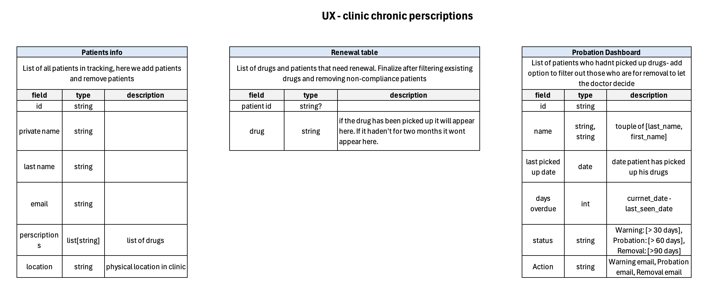

# Chrono-v2 System Design

## 1. Architecture Overview
This project uses a relational database model to track patients and their recurring treatment cycles. The structure ensures that patient data remains consistent even as multiple prescription cycles are added over time.

## 2. Core Business Logic: Probation Dashboard
The system automatically calculates a patient's status by comparing the `last_picked_up_date` to the current system date.

| Days Overdue | Status | System Action |
| :--- | :--- | :--- |
| **0 - 30** | `Active` | Normal monitoring; no alerts sent. |
| **31 - 60** | `Warning` | Trigger "Warning Email" notification. |
| **61 - 90** | `Probation` | Trigger "Probation Email"; flag for clinic priority. |
| **> 90** | `Removal` | Set status to "Inactive"; free up physical drawer location. |

## 3. Renewal Rules
A "Renewal" is defined as a new treatment cycle authorized for an existing patient.

* **Pre-condition**: A patient must have an `Active` or `Warning` status to be eligible for standard renewal.
* **Granularity**: Renewal tasks are managed individually for each specific drug in the patient's profile.
* **Audit Trail**: Every renewal action must link back to the original prescription ID for tracking and compliance.